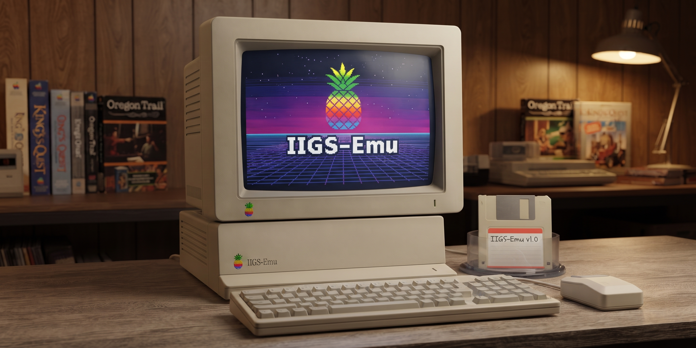

# IIGS-Emu

Originally based on [GSplus](https://github.com/digarok/gsplus), an Apple IIgs
emulator derived from [KEGS](http://kegs.sourceforge.net) by Kent Dickey.

## You'll need a ROM

Like any IIgs emulator, IIGS-Emu needs an Apple IIgs ROM file to boot. Without one
it starts into a configuration screen with nothing to run. The ROM is Apple's
copyrighted firmware, so IIGS-Emu can't ship it — you supply your own.

**Which ROM:** the IIgs shipped with two ROM versions. **ROM 03** (256 KB, the
later model) is the usual choice; **ROM 01** (128 KB) is also fully supported.
IIGS-Emu does **not** support the early ROM 0.

**Where to put it:** name the file `ROM`, `ROM.01`, or `ROM.03` and place it in
your home directory, next to the app, or next to your `config.kegs`. IIGS-Emu picks
it up automatically. You can also select one at runtime: press **F4 → ROM File
Selection → ROM File** and browse to it. A handful of other common names
(`APPLE2GS.ROM`, `APPLE2GS.ROM2`, `xgs.rom`, `342-0077-b`, …) are recognized too.

**Did it work?** A valid ROM 01 file is exactly **128 KB** and a ROM 03 is **256
KB**. If IIGS-Emu boots to the "Check startup device" screen, the ROM loaded fine —
it just needs a disk. Press **F4** to mount a disk image, or drag one onto the
window.

### What's been added in IIGS-Emu

Some features that are a part of the SDL3 build:

- **Window & display options** - `-fullscreen`, `-borderless`, `-noaspect`,
  `-highdpi`, `-nohwaccel`, plus window position; F11 toggles
  fullscreen.
- **Screenshot capture** - F10 writes the framebuffer to disk.
- **Gamepad support** - SDL_Gamepad mapped to the IIgs joystick.
  A connected gamepad is used automatically (with hotplug); without one, the
  numeric keypad emulates the joystick. The stick's circular travel is remapped
  to the square range Apple joysticks have, so games can reach the corners.
  Override either behavior in the config menu (F4) under Joystick
  Configuration.
- **Terminal debugger** - a REPL for the built-in 65816 debugger from the
  controlling terminal.
- **Drag-and-drop disk loading** - drop a disk image on the window and IIGS-Emu
  picks the slot from the WOZ disk type or the file size.
- **Centered 8-bit video modes** - 40/80-column text, GR, HGR and DHGR are
  560 pixels wide vs. super-hires' 640; IIGS-Emu centers them instead of
  GSplus's left-align. `-centera2 0` (or the Display Effects menu) restores
  the GSplus behavior.
- **CRT scanline simulator** - `-scanline <0-100>`, Shift+F11 to toggle.
- **Curved CRT effect** - `-crt 1` with `-crtcurve` / `-crtmask` / `-crtglow`
  / `-crtvignette`, Ctrl+F11 to toggle. Screen curvature, RGB phosphor mask,
  bloom, and vignette; composes with the scanline simulator.
- **xBRZ 2x filter** - `-xbrz 1` or the F4 Display Effects menu. Doubles the
  picture with a corner-smoothing filter and doubles the window size; CRT
  effects apply on top of it.
- **CMake build** - a single SDL3 app built with CMake and Ninja, with prebuilt
  GNU/Linux downloads.

## Controls

The following hotkeys let you dynamically change many of the emulator settings,
but you can also edit most settings by hitting `F4` for the configuration menu. 

| Key | Action | Source |
|---|---|---|
| **F1** | Open-Apple (⌘) modifier, for keyboards without an Apple/Command key | GS+ |
| **F4** | Open the configuration menu (mount disks, pick a ROM, settings) | GS+ |
| **F5** | Toggle the status line | GS+ |
| **F6** | Cycle emulation speed (1 MHz / 2.8 MHz / fast) | GS+ |
| **F7** | Toggle the debugger | GS+ |
| **Shift + F7** | Toggle fast disk emulation | GS+ |
| **F8** | Grab / release the mouse (warp + hide pointer) | GS+ |
| **F9** | Invert paddles | GS+ |
| **Shift + F9** | Swap paddles | GS+ |
| **Ctrl + F9** | Copy screen text to the clipboard | GS+ |
| **F10** | Save a screenshot | GS+ |
| **F11** | Toggle fullscreen | GS+ |
| **Shift + F11** | Toggle the CRT scanline effect | GS+ |
| **Ctrl + F11** | Toggle the CRT curved screen effect | GS+ |
| **Scroll Lock** or **middle-click** | Toggle mouse capture (confines the pointer to the window) | GS+ |
| **Ctrl + F12** | Reset the IIgs (Ctrl-Reset) | GS+ |

You can also **drag & drop** a disk image onto the window to mount it. WOZ images
go to slot 6 (5.25") or slot 5 (3.5") from their disk type; other images are
placed by file size.

## Building from source

IIGS-Emu builds with CMake (Ninja generator). SDL3 is used if installed, otherwise
built from source automatically. From the repository root:

```sh
cmake -G Ninja -B build -S src
cmake --build build --target gsplus-sdl
```

This produces the `build/iigs-emu` executable.

### Dependencies

You need a C compiler (GCC), CMake, Ninja, and git. SDL3 is used if installed;
otherwise it is built from source, which needs development headers for your
system's display and audio stacks:

- **X11 and Wayland:** the X11 extension libraries (Xext, Xrandr, Xcursor, Xi,
  Xfixes, Xss, Xtst, Xinerama), Wayland client and protocol files, libdecor, and
  xkbcommon.
- **Graphics:** DRM, GBM, EGL, and OpenGL/GLES.
- **Audio:** PulseAudio, ALSA, PipeWire, and sndio.
- **Other:** D-Bus, udev, and IBus.

Package names vary by distribution. Search your package manager for the matching
`-dev` or `-devel` packages.
